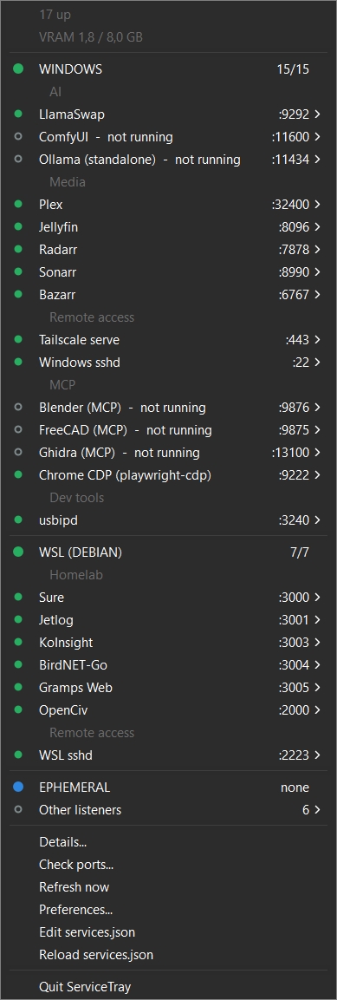
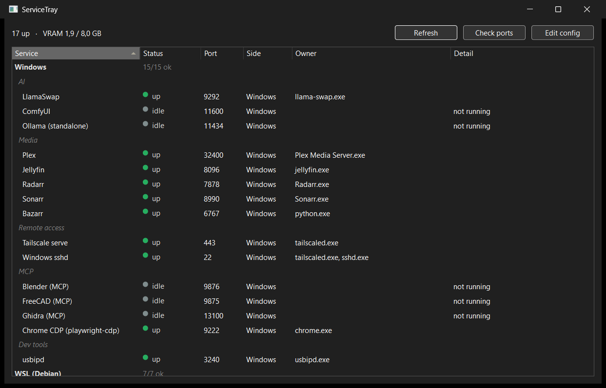

# ServiceTray

A Windows system-tray monitor for services on Windows **and** in WSL: what is listening
on which port, whether it answers, and whether its Docker container is healthy. Written
in [Xojo](https://xojo.com); a sibling of [LlamaTray](https://github.com/3-mmc/llama-tray).

<p>
  
  
</p>

The real thing, on the machine it was written for: 22 services across Windows and a WSL
Debian (media stack, local AI gateway, self-hosted apps in Docker, MCP backends), with
the menu on the left and *Details...* on the right.

- **Icon colour:** green when every service is up, orange when one is degraded (port open
  but the health check fails, or Docker says unhealthy), red when one is down, grey
  before the first probe or when the config is missing. Inside the disc, LlamaTray's
  white bar shows VRAM use.
- **Tooltip:** counts plus the names of anything not up, running models, VRAM.
- **Click:** every service at a glance: a coloured status dot in the menu's icon gutter
  (hollow = idle), the name beside it, `:port` in a right-aligned column. Each service has a submenu (Open, Restart…,
  Copy port); the llama-swap entry also has LlamaTray's Unload / Unload all / Load menu,
  with the running models listed beneath it.
- **Ephemeral:** listeners nobody configured that appeared *after* ServiceTray started,
  such as a dev server or a demo on `localhost:xxxx`, with owner and start time. WSL
  processes are named when they run as your user (`python3 (WSL)`). Whatever was already
  listening at start goes under *Other listeners*.
- **Details…:** a window with the same sections as a table (status, port, side, owner,
  detail). Double-click opens a service; right-click gives the same actions as the menu.
  WSL is polled every 5 s while it is open.
- **Preferences…:** sort by environment (Windows / WSL, categories as grey sub-labels;
  the default), by category, by port or by name; fold fully healthy sections; hide idle
  optional services; show only a port range (e.g. 3000–9999). Saved to `settings.json`.
- **Check ports…:** see below.
- **Double-click:** refresh now.
- **`%APPDATA%\ServiceTray\status.txt`:** the same view, tab-separated, rewritten only
  when something changes, for scripts and agents.

## Where the data comes from

| Source | How | Default interval |
|---|---|---|
| Windows listeners | `GetExtendedTcpTable` + a Toolhelp snapshot, in-process (no netstat) | 5 s |
| WSL listeners + Docker | one `wsl.exe -e sh -c "ss -ltnH; docker ps -a …"` call | 15 s |
| Health | HTTP GET per service, only while its port is listening | per service (`every`), default 30 s |
| llama-swap | one long-lived `GET /api/events` stream; model changes are pushed (falls back to LlamaTray's `/running` polling if the stream never delivers) | push |
| VRAM | `nvidia-smi` | 5 s while a model is loaded, else 30 s |

Under WSL's **mirrored networking**, WSL's listening ports do not show up in Windows'
TCP table at all, which is why the WSL side is probed separately. Before probing, the app
checks `wsl.exe -l --running`, so it never boots a stopped distro.

Everything marks the view dirty; it is rebuilt at most once a second, and only when
something changed. Process names for the Windows table are cached between scans.

Measured cost (2026-10-15): about 0.4 CPU-seconds per minute and 11 MB private memory.
An earlier build read VRAM through `nvml.dll`, which kept about 45 MB of driver
components resident (82 MB in total) and polled llama-swap every 3 s (0.8 s/min).

## Port check

Ports get "eaten" on this machine in two ways that look the same from the outside (the
service cannot bind, `netstat` shows nothing):

1. **Windows excluded ranges.** Hyper-V/WinNAT lease port blocks, listed by
   `netsh int ipv4 show excludedportrange protocol=tcp`.
2. **Mirrored-networking phantoms.** A dead WSL process leaks the mirrored reservation:
   Windows refuses the port, nothing lists a holder, but WSL can still bind it.

*Check ports…* takes every configured port that nothing is listening on, plus
`checkPorts` from `services.json` (numbers or `"from-to"`). It tries a real bind on
Windows (Winsock, microseconds per port), compares failures against the excluded ranges,
and for the remaining failures asks WSL to bind the same ports. Each failure gets a
verdict: *reserved by Windows (range a–b)*, *phantom*, or *unbindable on both sides*. The
verdict also shows up next to the affected service. When a required Windows service goes
down, its port is checked automatically (at most every 5 minutes).

Being inside an excluded range does not by itself block a bind. On 2026-10-15,
11520–11535 and 11600 were administered exclusions and all of them bound fine. So the
check only reports ports that actually fail.

## Configuration

`%APPDATA%\ServiceTray\services.json`. See `services.example.json`. An empty file is
created on first run. Edits are picked up on their own: the file's modification time is
checked on every Windows scan (5 s), and *Reload services.json* is still in the menu.

**Moved services.** When a service's port goes quiet while its own process listens on a
port nobody configured, the service shows as degraded with *Sonarr.exe is listening on
:8990 instead* rather than down. Its submenu then offers *Use :8990*. *Change port...* is
on every service. Both rewrite only that service's entry in `services.json` (its `port`
and every `:<old port>` in its URLs), keep the hand formatting, and save the previous
file as `services.json.bak`. The process is recognised by the `process` key, by the owner
seen while the service was last up (unless another service shares it, as with
`python3`), or by an exe named like the service (`Sonarr` = `Sonarr.exe`). For Docker
services the container's published ports are used.

| Key | Meaning |
|---|---|
| `side` | `win` or `wsl` |
| `port` | the port that must be listening (0 = don't check) |
| `health` | URL; any HTTP status below 500 counts as alive |
| `every` | seconds between health checks for this service |
| `docker` | container name; not running = down, unhealthy = degraded |
| `optional` | down shows as idle (grey ○) and does not turn the icon red |
| `open` | URL for the Open item |
| `restart` | command; a `wsl:` prefix runs it inside the distro |
| `group` | category (AI, Media, …), shown as a sub-label or used for the category sort |
| `process` | exe (or WSL process) that owns the port: used for move detection, and anyone else holding the port shows as *taken by …* (degraded) |
| `reserved` | a port kept free for a program that only listens now and then (Spotifast's OAuth callback on 8989): free = idle *free (reserved)*, its own program = up *in use*, anything else = degraded; never flagged as moved |

MCP servers mostly speak stdio and open no port, so they cannot be watched directly. The
example config instead watches the app each one drives (Blender addon :9876, FreeCAD bridge
:9875, Ghidra's GhidraMCP plugin :13100, the CDP Chrome :9222) as optional entries in an `MCP` group. FreeCAD's bridge also
opens a JSON-RPC socket on 9876, so with FreeCAD open and Blender closed the Blender line
reads up.

The top-level keys are `wslDistro`, `windowsEvery`, `wslEvery`, `healthEvery`,
`ignorePorts`, `ignoreFrom` (unlisted ports at or above this are hidden; the default is
49152, the ephemeral range), `checkPorts`, and `llamaSwap` (`{"url": …, "service": <name
of the llama-swap entry>}`, which turns on the model menu).

View options live separately in `settings.json`, written by the Preferences window.

Command-line flags: `--details` and `--prefs` open those windows at start;
`--check-ports` runs the port check after 8 s (results land in `status.txt`); `--menu`
pops the tray menu up at the mouse after 6 s (for screenshots).

Health checks send `Accept-Encoding: identity`: URLConnection fails on Brotli bodies
(Gramps Web serves them) with "Error occurred while receiving data".

## Building

Same as LlamaTray: open `ServiceTray.xojo_project` in Xojo 2026r2+ and build for Windows
64-bit, or from WSL:

```sh
tools/xojo-ide build 'D:\Projekte\service-tray\ServiceTray.xojo_project'
```

Quit the running ServiceTray before rebuilding; the exe is locked while it runs.

## Licence

MIT
